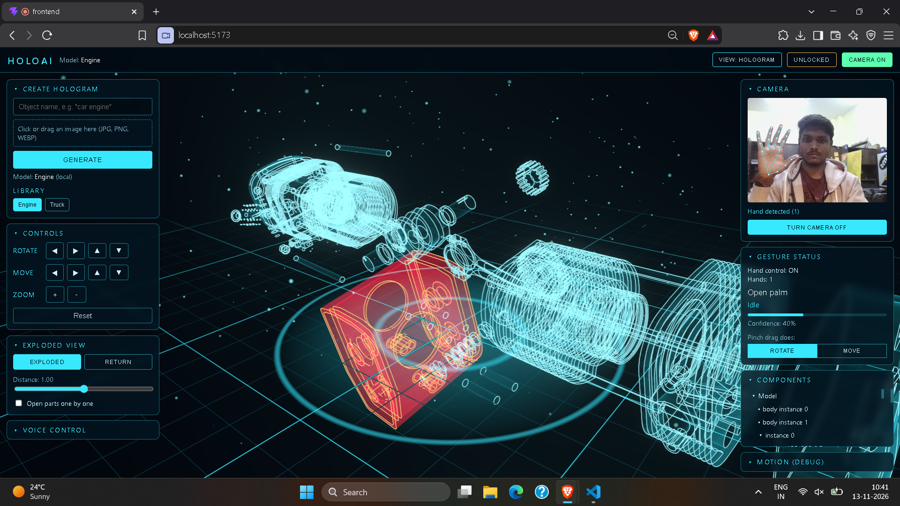

# HoloAI

An interactive 3D **hologram-style viewer** you control with your **hands** through a webcam, or with your **voice**. It runs in the browser on a normal screen: no projection hardware, just shaders, glow and real-time hand tracking.

**Live demo:** _add your Vercel link here_ (the API sleeps when idle, so the first request can take about 30 seconds)



## Features

- **Hologram rendering:** custom GLSL shader with fresnel rim light, scan lines, flicker, glowing edge outlines, bloom, particles and a grid floor
- **Solid view:** switch to a lit, shadowed material view with a built-in studio environment
- **Hand gesture control:** MediaPipe hand tracking with smoothing, dead zones, hysteresis, debouncing and cooldowns, so webcam noise doesn't shake the model
- **Component interaction:** hover, select, isolate and move individual parts, with a component tree built from the model's real hierarchy
- **Exploded view:** parts glide apart along their own direction, with an adjustable distance and step-by-step opening
- **Lock mode:** freeze the model so stray gestures can't change it
- **Voice and typed commands:** "explode", "next part", "select piston", "solid view", "load gearbox" (typed commands work in every browser)
- **Model library and prompt input:** pick a model, type an object name, or add an image. The backend validates uploads and matches names to a model catalog
- **Swappable generator:** model creation sits behind one interface (`ModelGenerator`), so a real text-to-3D or image-to-3D service can replace the catalog matcher
- **Tested backend:** pytest suite for the API, upload validation and model matching

## Gestures

| Gesture | Action |
|---|---|
| Pinch + move hand | Rotate (or move, via a toggle) |
| Pinch + tilt wrist | Roll the model |
| Both hands pinch, spread apart / together | Zoom in / out |
| Point with index finger | Highlight a part |
| Point + hold still for 1 second, or pinch with the other hand | Select it |
| Point, then touch index and middle fingers together | Grab the part and move it |
| Both open palms, spread apart / together | Explode / return |
| Open palm, quick swipe right / left | Open next / previous part |
| One fist held for 1 second | Reset view |
| Both fists held for about 1 second | Lock / unlock |

Mouse and on-screen buttons work as a fallback.

## Tech stack

- **Frontend:** React, TypeScript, Vite, Three.js, React Three Fiber, drei, postprocessing, Zustand
- **Hand tracking:** MediaPipe Tasks Vision (`HandLandmarker`), model and WASM files served locally
- **Voice:** Web Speech API (Chrome and Edge), with a typed-command fallback
- **Backend:** Python, FastAPI, Pydantic, Pillow, pytest

## Run it locally

You need Node 18+ and Python 3.10+. Use Chrome, Edge or Brave. The webcam only works on `localhost` or HTTPS.

**Backend**

```bash
cd backend
python -m venv venv
venv\Scripts\activate          # macOS/Linux: source venv/bin/activate
pip install -r requirements-dev.txt
cp .env.example .env           # Windows: copy .env.example .env
uvicorn app.main:app --reload --port 8000
pytest                         # run the tests
```

**Frontend** (in a second terminal)

```bash
cd frontend
npm install
npm run dev
```

Open http://localhost:5173, click **Camera OFF** in the header (or **Turn camera on**) and allow the camera. API docs are at http://localhost:8000/docs.

To point the website at another API, create `frontend/.env` with `VITE_API_URL=https://your-api.example.com`.

## Deploy

- **API:** Render web service, root directory `backend`, build `pip install -r requirements.txt`, start `uvicorn app.main:app --host 0.0.0.0 --port $PORT`. Set `CORS_ORIGINS` to the website address.
- **Website:** Vercel, root directory `frontend`, environment variable `VITE_API_URL` set to the API address.

## Project structure

```
frontend/src/
  components/   UI panels (header, viewer, gestures, tree, exploded view, upload, voice)
  three/        shader material, model manager, exploded-view controller, hand picker
  gestures/     hand tracker, gesture recognizer, motion tracker, mapper, filters
  voice/        command parser and speech wrapper
  store/        Zustand stores
  api/          backend client
backend/app/
  api/routes/   upload, analyze, generate, catalog and model endpoints
  services/     model catalog, image analysis, generators (base + catalog matcher)
  utils/        upload validation and id checks
backend/tests/  pytest suite
```

## Status and roadmap

- [x] Hologram and solid viewer with rotate, move, zoom and reset
- [x] Webcam hand tracking and gesture recognition
- [x] Component selection, highlighting, isolation, moving and tree
- [x] Exploded view with sequential opening
- [x] Lock mode, voice and typed commands
- [x] Model library, text and image input, upload validation, API and tests
- [ ] Real text-to-3D / image-to-3D generation (currently a **catalog matcher** that picks a model by keyword)
- [ ] Automatic image recognition (an uploaded image currently reports size, format and color only)

AI-generated models are usually a single fused mesh, so the component tree and exploded view work best on multi-part models.

## Credits

Sample models are from the [Khronos glTF Sample Models](https://github.com/KhronosGroup/glTF-Sample-Models) collection (2CylinderEngine, CesiumMilkTruck, GearboxAssy and ReciprocatingSaw). Check their licenses before reusing.
