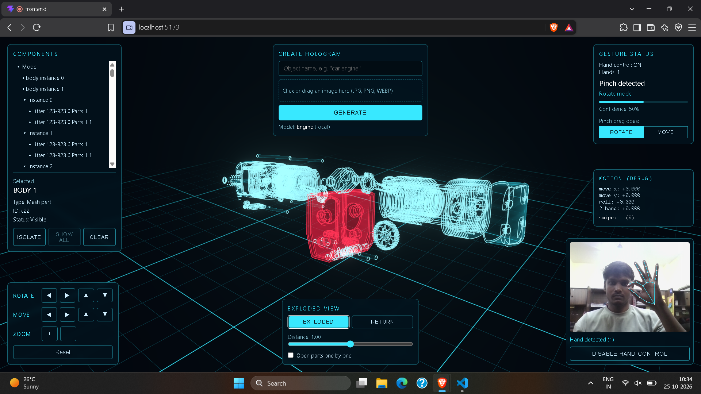

# HoloAI

An interactive 3D **hologram-style viewer** you control with your **hands** through a webcam. It runs entirely in the browser on a normal screen: no projection hardware, just shaders, glow and real-time hand tracking.



## Features

- **Hologram rendering:** custom GLSL shader with fresnel rim light, scan lines, flicker, glowing edge outlines, bloom and a grid floor
- **Hand gesture control:** MediaPipe hand tracking with smoothing, dead zones, hysteresis, debouncing and cooldowns, so webcam noise doesn't shake the model
- **Component interaction:** hover, select and isolate individual parts, with a component tree built from the model's real hierarchy
- **Exploded view:** parts glide apart along their own direction, with an adjustable distance and step-by-step opening
- **Pointing:** aim at a part with your index finger, then hold still or pinch with the other hand to select
- **Model input:** text prompt, image upload and drag-and-drop, backed by a FastAPI service with validated uploads
- **Swappable AI backend:** the generator sits behind one interface (`ModelGenerator`), so a real text-to-3D or image-to-3D service can replace the mock

## Gestures

| Gesture | Action |
|---|---|
| Pinch + move hand | Rotate (or move, via a toggle) |
| Pinch + tilt wrist | Roll the model |
| Both hands pinch, spread apart / together | Zoom in / out |
| Open palm | Release / pause |
| Fist held for 1 second | Reset view |
| Point with index finger | Highlight a part |
| Point + hold still for 1 second, or pinch with the other hand | Select it |
| Both open palms, spread apart / together | Explode / return |
| Open palm, quick swipe right / left | Open next / previous part |

Mouse and on-screen buttons work as a fallback.

## Tech stack

- **Frontend:** React, TypeScript, Vite, Three.js, React Three Fiber, drei, postprocessing, Zustand
- **Hand tracking:** MediaPipe Tasks Vision (`HandLandmarker`)
- **Backend:** Python, FastAPI, Pydantic, Pillow

## Run it locally

You need Node 18+ and Python 3.10+. Use Chrome, Edge or Brave. The webcam only works on `localhost` or HTTPS.

**Backend**

```bash
cd backend
python -m venv venv
venv\Scripts\activate          # macOS/Linux: source venv/bin/activate
pip install -r requirements.txt
cp .env.example .env           # Windows: copy .env.example .env
uvicorn app.main:app --reload --port 8000
```

**Frontend** (in a second terminal)

```bash
cd frontend
npm install
cp .env.example .env           # Windows: copy .env.example .env
npm run dev
```

Open http://localhost:5173, click **Enable Hand Control** and allow the camera. The hand tracker downloads its model file on first use, so you need an internet connection once.

API docs are at http://localhost:8000/docs.

## Project structure

```
frontend/src/
  components/   UI panels (viewer, gestures, tree, exploded view, upload)
  three/        shader material, model manager, exploded-view controller, hand picker
  gestures/     hand tracker, gesture recognizer, motion tracker, mapper, filters
  store/        Zustand stores
  api/          backend client
backend/app/
  api/routes/   upload, analyze, generate, model endpoints
  services/     model service, image analysis, generators (base + mock)
  utils/        upload validation and filename sanitizing
```

## Current status and roadmap

- [x] Hologram viewer with rotate, move, zoom and reset
- [x] Webcam hand tracking and gesture recognition
- [x] Gesture-to-model controls
- [x] Component selection, highlighting, isolation and tree
- [x] Exploded view with sequential opening
- [x] Text and image input, upload validation, API
- [ ] Real image analysis (currently a placeholder that reads size and dominant color)
- [ ] Real text-to-3D / image-to-3D generation (currently a **mock** that picks a model from a small library by keyword)
- [ ] Voice commands

AI-generated models are usually a single fused mesh, so the component tree and exploded view work best on multi-part models.

## Credits

Sample models are from the [Khronos glTF Sample Models](https://github.com/KhronosGroup/glTF-Sample-Models) collection (CesiumMilkTruck and 2CylinderEngine). Check their licenses before reusing.